<div align="center">

  <h1>SeeHere</h1>

  <h3>Hear what the lecture shows, not just what it says.</h3>

  <p>
    Evidence-grounded audio descriptions for lecture videos,
    making visual learning more accessible to blind and low-vision students.
  </p>


**HackGlobal 2026 · Track 02: Multimodal & Accessibility**

**[▶ Live demo](https://65-20-87-43.sslip.io)** · **[📊 Live status](https://65-20-87-43.sslip.io/status)** · [How it works](#9-multimodal-pipeline) · [Evidence ledger](#10-the-visual-evidence-ledger) · [Run it locally](#14-local-installation) · [Measured results](#19-benchmarks-and-measured-results)

</div>

---

> **For judges: try it live**
>
> | Link | What you will see |
> |---|---|
> | [Live app](https://65-20-87-43.sslip.io) | Upload a lecture (or open the demo project) and watch the 14-stage pipeline run |
> | [Demo lecture results](https://65-20-87-43.sslip.io/projects/bfaa58c7-1351-4483-bdfa-845e23ee6a98/results) | The described video, transcript, evidence ledger and the 9 export files |
> | [Demo video (4:16)](demo-video/SeeHere_HackGlobal_Demo.mp4) | The full walkthrough recorded on the live Vultr deployment, with narration and captions ([script](demo-video/narration-script.md) · [storyboard](demo-video/storyboard.md)) |
> | [Live status](https://65-20-87-43.sslip.io/status) | Real-time health of the API, database and media tools, measured stage timings, and every Vultr Serverless Inference call with tokens and latency |
> | [`/api/metrics`](https://65-20-87-43.sslip.io/api/metrics) · [`/api/health`](https://65-20-87-43.sslip.io/api/health) | The same numbers as raw JSON |

## 1. Overview

SeeHere takes a recorded lecture and produces audio descriptions of what is on screen that the lecturer never says aloud. Each description is traceable to its evidence: the frame, the region, the text read on screen, the slide and the transcript. Descriptions are placed in the natural pauses of speech and voiced. An instructor can approve, edit, reject or regenerate each one before anything is published.

The output is standard: a WebVTT description track, a described MP4, an extended MP4 that pauses the video where needed, the voice clips, an accessible transcript, a coverage and verification report, and a manifest that records the evidence behind every line.

<p align="center">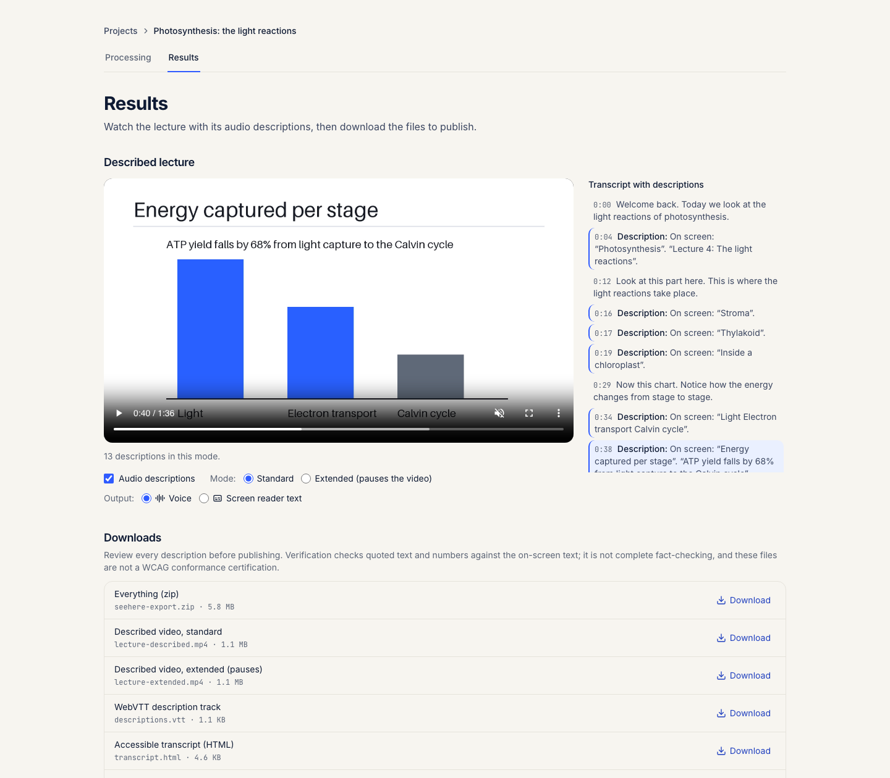</p>

## 2. The accessibility problem

Lectures are visual. A lecturer points at a chart and says _"notice how this one drops here"_. A sighted student sees which bar. A blind student hears only a pointer to something they cannot see, and a screen reader cannot help, because the information is in the video's pixels, not in any text.

Audio description fixes this, but describing a lecture by hand takes hours per hour of video, so most course video never gets it. Automatic tools fill the gap with model-generated text. In education that is risky: a confidently wrong number in a description of a chart is worse than no description, and the listener has no way to check it.

## 3. Our solution

SeeHere treats every description as a claim that needs evidence:

1. **Find what is shown but not said.** It compares what is visible (on-screen text, visual units from a vision model, optional slide deck) with what was said near that moment. Only the unsaid parts are described.
2. **Resolve spoken pointers.** Phrases such as "this part here" are linked to a screen region with a confidence. Ambiguous ones are flagged.
3. **Write only from evidence.** Descriptions are built from the fields of a visual unit. Every quoted string and number is checked against the text read on screen or in the deck.
4. **Speak in the gaps.** A constraint solver (OR-Tools CP-SAT) places descriptions in pauses without talking over the lecturer. The real length of each synthesized clip is measured, and the schedule is re-solved if a clip does not fit.
5. **Keep a person in the loop.** Anything that cannot be verified is held from the schedule until an instructor approves it.

## 4. Why SeeHere matters

- **Verifiable, not just generated.** Most AI audio-description tools give you text. SeeHere gives you text plus the evidence trail and a per-claim verification state, so an instructor can check a description in seconds instead of rewatching the video.
- **Respects the lecture.** Standard mode never talks over speech. Extended mode pauses the picture only within a stated time budget, and records the reason for each pause.
- **Cheap to run.** Speech-to-text, OCR, scheduling and the voice all run locally on the server. A hosted vision model is optional and metered.
- **Honest about limits.** The UI, the exports and this README say plainly that matching text is evidence, not complete fact-checking, and that nothing here is a WCAG conformance certification.

## 5. Key features

| Area              | What works today                                                                                                                                                                 |
| ----------------- | -------------------------------------------------------------------------------------------------------------------------------------------------------------------------------- |
| Upload            | Content-checked video upload (ffprobe, not file extensions), up to 500 MB and 30 minutes, rights confirmation, optional PDF/PPTX slide deck.                                     |
| Processing        | 14 queued pipeline stages with live progress, cancel and retry, crash recovery, and automatic deletion after 24 hours.                                                           |
| Hearing           | Local faster-whisper (`small.en`) transcript with word timings; speech windows derived from word gaps.                                                                           |
| Seeing            | Slide-change detection with keyframe deduplication, Tesseract OCR with confidence and boxes, and visual units from Gemini or Vultr vision models (falls back to OCR-only units). |
| Seen versus said  | Each visual unit is scored against speech in a ±5 s window; unsaid content is ranked first.                                                                                      |
| Spoken references | "This", "here", "the blue line" linked to regions, or flagged as ambiguous.                                                                                                      |
| Evidence ledger   | Every description links to unit → frame/region → OCR lines → slide → transcript → checks → review decisions.                                                                     |
| Verification      | Quotes and numbers checked against OCR and slide text: verified text match, corroborated, uncertain or needs review.                                                             |
| Scheduling        | Greedy and CP-SAT solvers on identical inputs, compared and validated; extended mode with a pause budget.                                                                        |
| Voice             | Piper TTS (local), with measured clip length, up to 3 re-scheduling rounds, and a recorded reason for anything skipped.                                                          |
| Review            | Approve, edit, reject or regenerate next to the evidence. Edits are re-verified; decisions survive regeneration.                                                                 |
| Player            | Accessible player in standard or extended mode, with voice or `aria-live` screen-reader text and a synced transcript.                                                            |
| Exports           | WebVTT, described MP4, extended MP4, WAV clips, HTML transcript, coverage report (HTML/JSON) and a hashed manifest, also bundled as a zip.                                       |
| Operations        | Per-job run time, CPU, memory and hosted-model calls on the Status page; security headers, rate limits and write-request guard.                                                  |

## 6. Screenshots

All screenshots come from the production Docker build, processing the demo lecture made by [`seehere.bench.demo`](backend/src/seehere/bench/demo.py). The evidence ledger screenshot uses the Gemini vision run; the others use OCR-only mode.

|                                                                                                                                                                                                                      |                                                                                                                                                                                              |
| -------------------------------------------------------------------------------------------------------------------------------------------------------------------------------------------------------------------- | -------------------------------------------------------------------------------------------------------------------------------------------------------------------------------------------- |
| 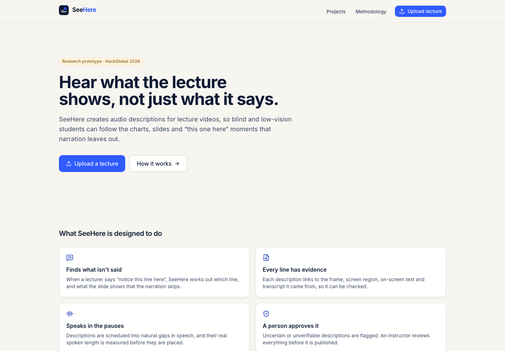 **Landing page**                                                                                             | 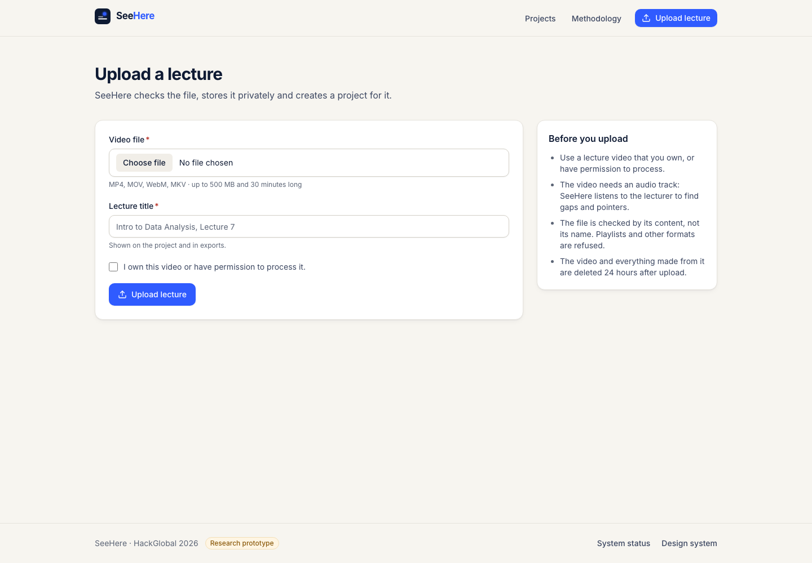 **Upload**                                                          |
| 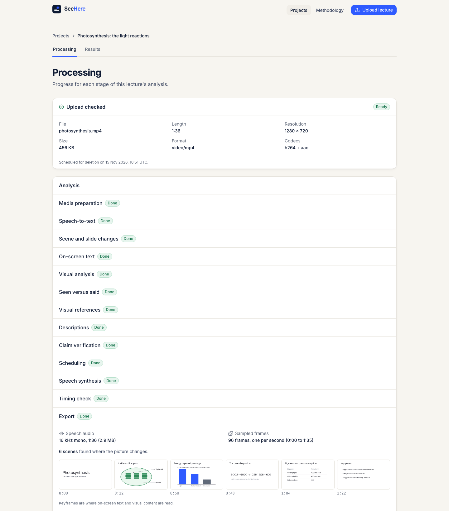 **Processing: stages and keyframes**                                                         | 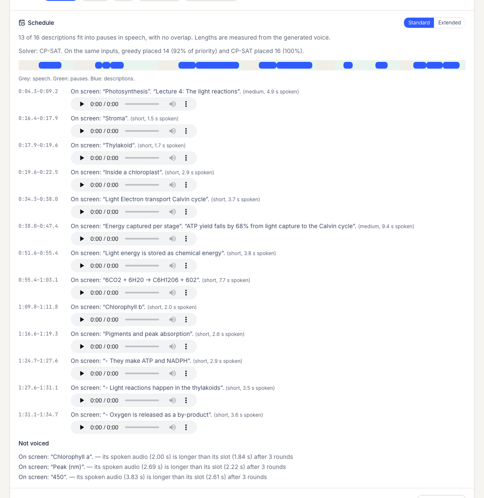 **Schedule: CP-SAT placement and voice clips** |
| 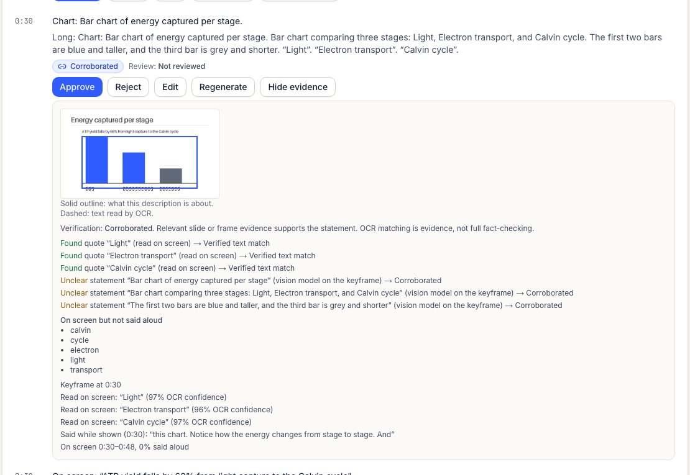 **Evidence ledger and review** | 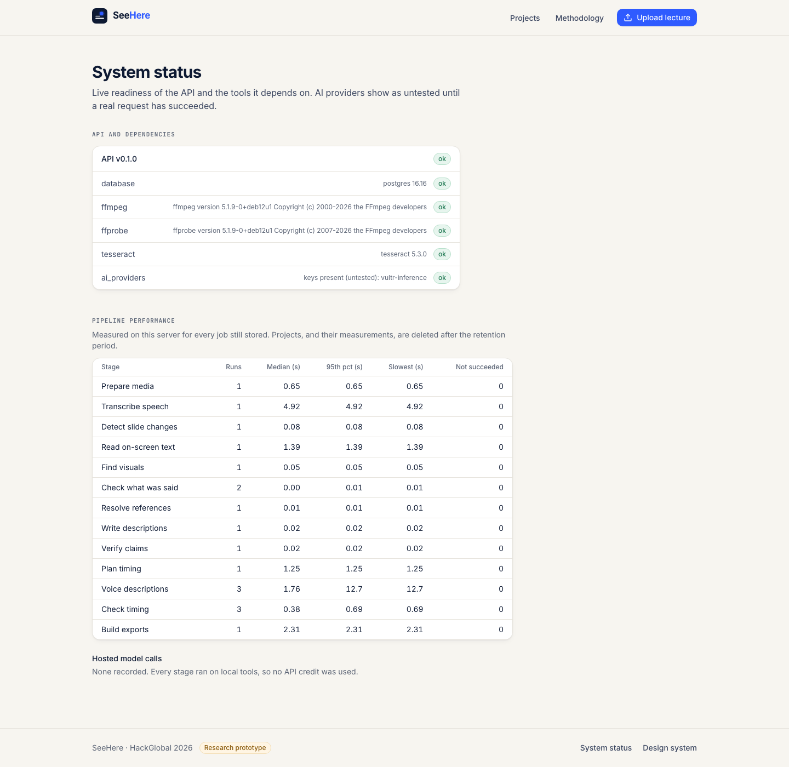 **Status: health and measured performance**                                  |

## 7. System architecture

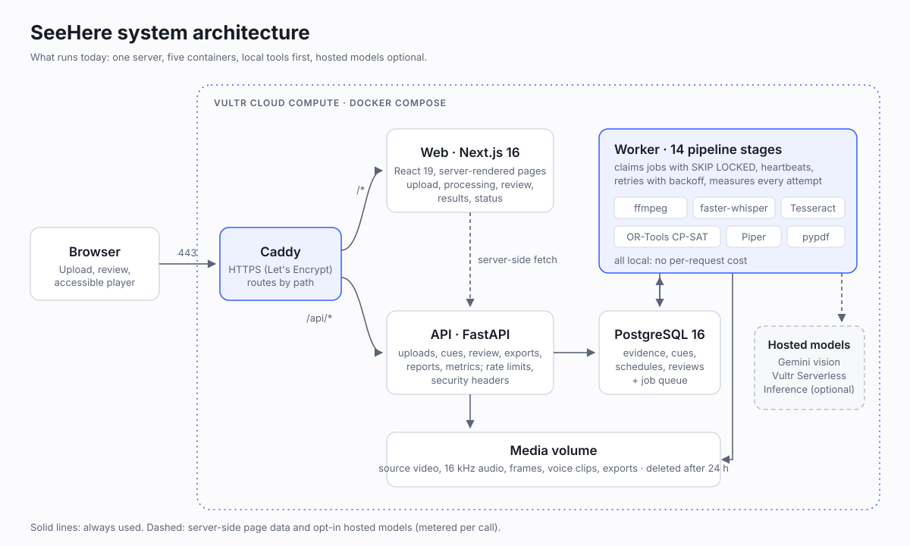

- **Web (Next.js 16, React 19):** server-rendered pages. Data is fetched server-side from the API over the internal Docker network.
- **API (FastAPI):** upload, review, exports, reports and metrics. Every write needs the `X-SeeHere-Request: 1` header; requests are rate-limited; responses carry strict security headers.
- **Worker:** claims jobs from a Postgres queue with `SELECT … FOR UPDATE SKIP LOCKED`, heartbeats, retries with backoff, and records run time, CPU, memory and provider calls for every attempt.
- **PostgreSQL 16:** stores both the data and the job queue. There is no separate broker.
- **Media volume:** source video, audio, frames, clips and exports. A retention sweep deletes them after 24 hours.

## 8. Technology stack

| Layer          | Technology                                                                                                           | Why                                                  |
| -------------- | -------------------------------------------------------------------------------------------------------------------- | ---------------------------------------------------- |
| Frontend       | Next.js 16, React 19, TypeScript, Tailwind CSS, Radix UI                                                             | Server-rendered, accessible primitives               |
| Backend        | Python 3.12, FastAPI, SQLAlchemy 2, Alembic, Pydantic                                                                | Typed API and migrations                             |
| Queue and data | PostgreSQL 16 (`SKIP LOCKED` queue, JSONB metrics)                                                                   | One stateful service to run and back up              |
| Speech-to-text | faster-whisper `small.en`, int8 on CPU                                                                               | Word timings for gaps and pointer phrases            |
| Vision | Vultr Serverless Inference (`qwen3.8-flash-next`), or Gemini (`gemini-3.5-flash-lite`); both OpenAI-compatible, schema-validated JSON | Visual units with regions |
| OCR            | Tesseract 5.5 (TSV with boxes and confidence)                                                                        | Text evidence for verification                       |
| Slides         | pypdf, guarded in-memory PPTX parsing (defusedxml)                                                                   | Optional ground-truth text                           |
| Scheduling     | Google OR-Tools CP-SAT, plus a greedy baseline                                                                       | Optimal placement in speech gaps                     |
| Voice          | Piper (`en_US-ljspeech-medium`), run as a subprocess                                                                 | Local and free; real clip lengths                    |
| Media          | ffmpeg / ffprobe                                                                                                     | Normalization, frames, described and extended videos |
| Delivery       | Docker Compose, Caddy 2 (automatic HTTPS), Vultr Cloud Compute                                                       | Simple, reproducible, single VM                      |
| Quality | pytest, ruff, mypy (strict), vitest, axe-core, ESLint | 648 backend tests and 128 web tests |

## 9. Multimodal pipeline

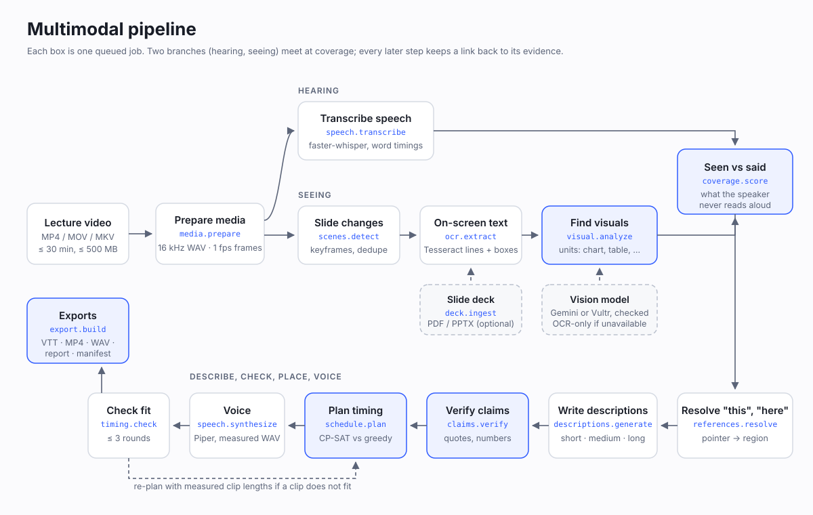

Each box is one queued job, and two branches run in parallel. **Hearing:** the transcript with word timings. **Seeing:** keyframes, then OCR, then visual units. They meet at the seen-versus-said score. Every later stage keeps foreign keys back to its inputs, so any spoken description can be traced to the pixels and words it came from.

The vision model receives one keyframe and a JSON Schema and must return visual units: kind, label, values, region and details. The response is validated locally before storage. Keyframes are analysed concurrently (4 at a time by default). If the hosted model stays unavailable after retries, the stage falls back to OCR text blocks instead of failing the lecture. A rejected API key stops the stage with a clear message and keeps earlier results.

## 10. The visual evidence ledger

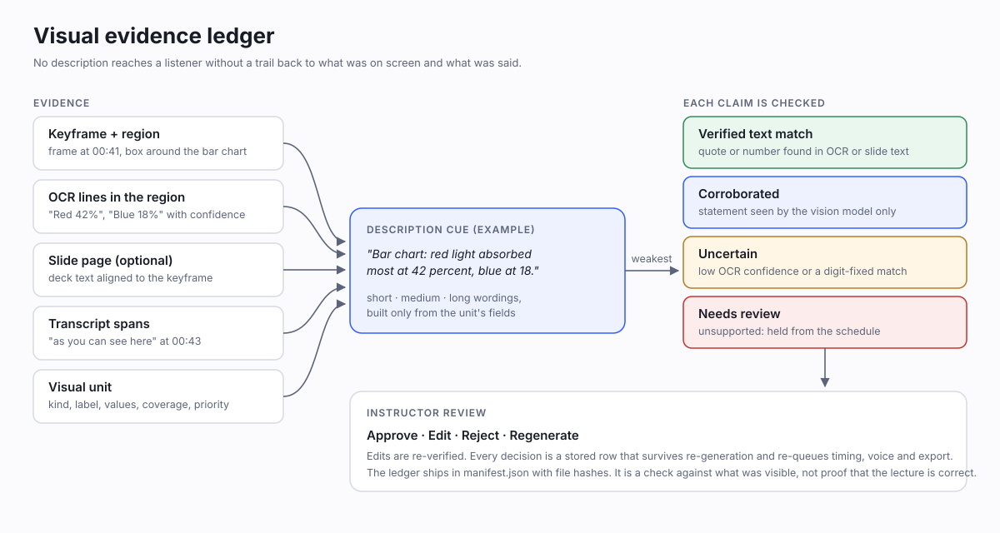

Every description cue stores `evidence` rows that point to the visual unit, the keyframe and region, each OCR line inside that region, the aligned slide page and the transcript spans. `claims.verify` extracts every quote, number and statement from all three wordings (short, medium, long) and checks each one:

| State                   | Meaning                                                                                                                       |
| ----------------------- | ----------------------------------------------------------------------------------------------------------------------------- |
| **Verified text match** | The quoted text or number was found as written in OCR (line confidence ≥ 0.6) or in the slide deck.                           |
| **Corroborated**        | A descriptive statement backed only by the vision model's view of the keyframe.                                               |
| **Uncertain**           | Found only in a low-confidence OCR line, or after repairing letters OCR reads in place of digits (for example `1O0` → `100`). |
| **Needs review**        | Not found in any evidence. The cue is held from the schedule until an instructor approves it.                                 |

A cue takes the weakest state of its claims. The ledger is shown in the UI (screenshot above) and shipped in `manifest.json` with SHA-256 hashes of every exported file.

> **A real example from the demo.** In both the Vultr and the Gemini runs, the vision model correctly read the equation as `6CO2 + 6H2O → C6H12O6 + 6O2`. OCR had read it as `6CO2 + 6BH20 -> C6H1206 + 602`. The quote did not match the OCR text, so the cue was **held for review** rather than voiced. That is the intended behaviour: a disagreement between two readings goes to a person.

## 11. Constraint scheduling

Descriptions must fit into pauses in the lecturer's speech. `schedule.plan` builds speech windows from word gaps (minus 0.15 s of padding, at least 0.8 s long). It then solves the placement twice on identical inputs:

- **Greedy:** highest priority first, using the longest wording that fits.
- **CP-SAT:** one interval per cue and wording, with a single `NoOverlap` constraint. The objective is lexicographic: maximise priority placed, then spoken seconds, then earliness. It runs with a single worker and a fixed seed, so it is deterministic.

CP-SAT is selected when its plan is valid and at least as good on priority. Both runs are stored with a comparison, which the UI shows. On the demo lecture, greedy placed 14 descriptions (92% of priority) and CP-SAT placed all 16 (100%).

**Extended mode** starts from the selected plan. It lets remaining cues pause the video at word boundaries, within `EXTENDED_PAUSE_BUDGET_PCT` of the lecture length, and records why each pause was needed.

**Timing check:** after Piper synthesizes each clip, `timing.check` compares the measured WAV length with its slot. If a clip does not fit, the plan is re-solved with the measured lengths, up to 3 rounds; anything that still does not fit is removed and reported with the reason. Independent validators check every run for overlap with speech and with other descriptions.

## 12. Vultr infrastructure and deployment

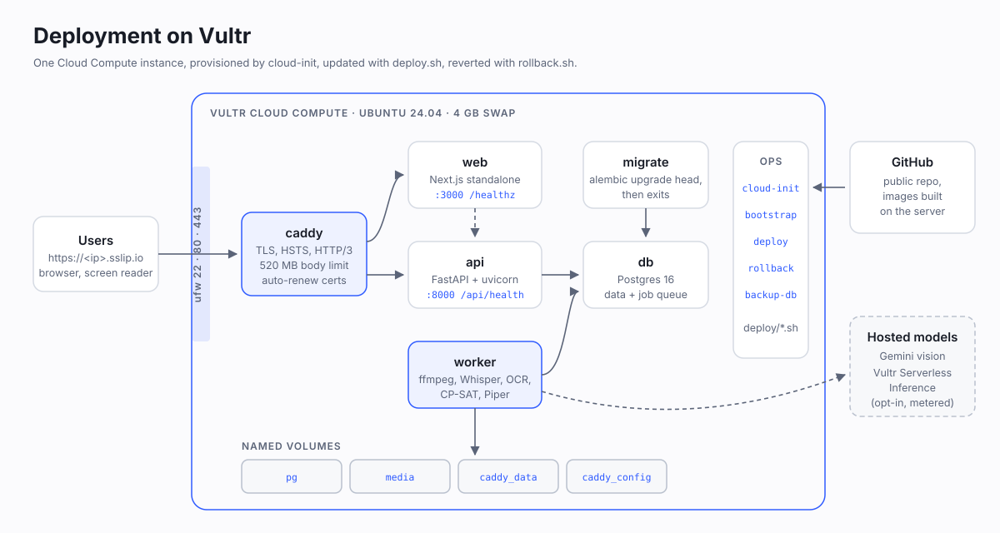

SeeHere runs on one **Vultr Cloud Compute** instance (Ubuntu 24.04) with Docker Compose:

- **Caddy** handles HTTPS with automatic Let's Encrypt certificates on `<ip>.sslip.io`, plus HSTS and HTTP/3.
- The **web**, **api** and **worker** containers run the application.
- A one-shot **migrate** container runs Alembic.
- **Postgres** holds data and the job queue.

Data lives on named volumes. Only ports 22, 80 and 443 are open.

Provisioning is one paste: [`deploy/cloud-init.yaml`](deploy/cloud-init.yaml) runs [`deploy/bootstrap.sh`](deploy/bootstrap.sh) on first boot. It installs Docker, sets up the firewall and swap, generates secrets and starts the stack. Updates, rollback and backups are each one script. The full guide is [docs/DEPLOYMENT.md](docs/DEPLOYMENT.md).

**How Vultr is used:**

- **Cloud Compute** hosts the whole product: frontend, backend, worker and database.
- **Vultr Serverless Inference** is the vision model (`VISION_PROVIDER=vultr`, `qwen3.8-flash-next`). It reads each keyframe and returns schema-validated visual units. The client classifies errors, retries outages and meters every call.
- Vultr text-to-speech and speech-to-text adapters are also built and pass live tests. The demo keeps the local Piper voice and Whisper, which have no per-request cost.

Gemini is supported as an alternative vision provider through the same OpenAI-compatible client.

## 13. Sample workflow

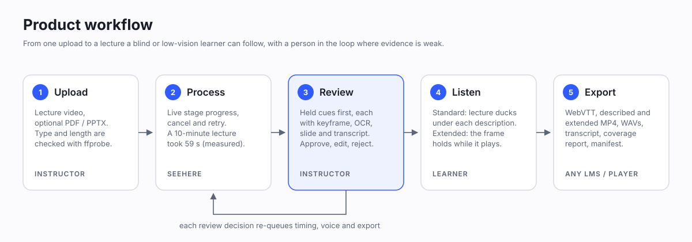

1. **Upload:** open `/upload`, choose a lecture video (and optionally its slides), enter a title and confirm you have the rights.
2. **Process:** the Processing page shows each stage live. The 96-second demo lecture was ready in 26.5 s with Vultr vision; a 10-minute lecture took 59 s.
3. **Review:** on the Processing page, each description shows its verification state. Open **Show evidence** to see the keyframe region, OCR text, slide text and transcript, then approve, edit, reject or regenerate. Held cues are never voiced until approved.
4. **Listen:** the Results page plays the lecture with descriptions in standard or extended mode, as a voice or as screen-reader text, with a synced transcript.
5. **Export:** download the WebVTT track, the described or extended MP4, the audio clips, the transcript, the report or everything as a zip.

## 14. Local installation

**Requirements:** Docker, Python 3.12 with [uv](https://docs.astral.sh/uv/), Node 20+ with pnpm, ffmpeg and Tesseract.

```bash
git clone https://github.com/priyansh-narang2308/seehere.git && cd seehere
cp .env.example .env                         # defaults work offline: OCR-only vision, Piper voice
make db-up                                   # Postgres 16 on 127.0.0.1:5433
cd backend && uv sync && cd ..
cd web && pnpm install && cp ../.env.example .env.local && cd ..
make api                                     # http://localhost:8000/api/health   (OpenAPI docs: /api/docs)
make worker                                  # the pipeline
make web                                     # http://localhost:3000
```

The first run of the worker downloads the Whisper `small.en` model and the Piper voice.

**A sample lecture.** `cd backend && uv run python -m seehere.bench.demo ../var/demo/photosynthesis.mp4` builds the 96-second, six-slide demo lecture used in this README. It needs macOS `say` for narration.

## 15. Environment variables

| Variable                                                     | Default                         | Purpose                                                       |
| ------------------------------------------------------------ | ------------------------------- | ------------------------------------------------------------- |
| `DATABASE_URL`                                               | local Postgres on :5433         | SQLAlchemy URL                                                |
| `MEDIA_DIR`                                                  | `./var/media`                   | Uploads, frames, audio, exports                               |
| `MEDIA_RETENTION_HOURS`                                      | `24`                            | Projects and files are deleted after this                     |
| `MAX_UPLOAD_MB` / `MAX_VIDEO_DURATION_S`                     | `500` / `1800`                  | Upload limits                                                 |
| `API_CORS_ORIGINS`                                           | `http://localhost:3000`         | Web origin allowed to call the API                            |
| `VISION_PROVIDER` | `none` | `none` (OCR only), `vultr` (used by the live demo) or `gemini` |
| `GEMINI_API_KEY` / `GEMINI_VISION_MODEL`                     | empty / `gemini-3.5-flash-lite` | Gemini vision                                                 |
| `VULTR_INFERENCE_API_KEY`                                    | empty                           | A **Serverless Inference** key, not the account API key       |
| `VULTR_VISION_MODEL` / `VULTR_TTS_MODEL` / `VULTR_STT_MODEL` | see `.env.example`              | Vultr models                                                  |
| `TTS_PROVIDER`                                               | `piper`                         | `piper` (local) or `vultr`                                    |
| `LOCAL_STT_MODEL`                                            | `small.en`                      | faster-whisper model                                          |
| `EXTENDED_PAUSE_BUDGET_PCT` / `SOLVER_TIME_LIMIT_S`          | see `.env.example`              | Scheduling limits                                             |
| `VULTR_PRICE_PER_*_USD`                                      | unset                           | Unit prices; a dollar estimate appears only when they are set |
| `SMALLEST_API_KEY`                                           | empty                           | Reserved; only reported by the health check                   |
| `NEXT_PUBLIC_API_BASE_URL`                                   | `http://localhost:8000`         | Browser API base (empty in production: same origin)           |

The production template is [`deploy/.env.prod.example`](deploy/.env.prod.example). `.env` files are git-ignored.

## 16. Docker Compose

```bash
cd deploy
cp .env.prod.example .env      # set SEEHERE_DOMAIN (e.g. localhost) and POSTGRES_PASSWORD
docker compose -f docker-compose.prod.yml up -d --build
docker compose -f docker-compose.prod.yml ps   # api, web, db healthy; migrate exited 0
```

With `SEEHERE_DOMAIN=localhost`, Caddy serves `https://localhost` with a certificate from its own local CA (your browser will ask you to accept it). This exact stack was used for the screenshots. The 96-second lecture went from upload to ready in 31 s inside the containers.

## 17. API

OpenAPI docs are at `/api/docs`. Writes require `X-SeeHere-Request: 1`.

| Method     | Path                                                                         | Purpose                                                                                                           |
| ---------- | ---------------------------------------------------------------------------- | ----------------------------------------------------------------------------------------------------------------- |
| `POST`     | `/api/projects`                                                              | Upload a lecture. Raw body, with headers `X-SeeHere-Title`, `X-SeeHere-Filename` and `X-SeeHere-Rights-Confirmed` |
| `GET`      | `/api/projects`, `/api/projects/{id}`                                        | List and read projects                                                                                            |
| `GET`      | `/api/projects/{id}/jobs`                                                    | Stage status and progress · `POST /api/jobs/{id}/cancel`, `/retry`                                                |
| `POST/GET` | `/api/projects/{id}/deck`                                                    | Optional slide deck                                                                                               |
| `GET`      | `/api/projects/{id}/transcript`, `/ocr`, `/media`, `/visuals`, `/references` | Evidence by stage                                                                                                 |
| `GET`      | `/api/projects/{id}/cues`, `/api/cues/{id}/evidence`                         | Descriptions and their ledger                                                                                     |
| `POST`     | `/api/cues/{id}/review`                                                      | `approve`, `reject`, `edit` or `regenerate`                                                                       |
| `GET`      | `/api/projects/{id}/schedule`, `/api/audio/{clip}`                           | Schedules and voice clips                                                                                         |
| `GET`      | `/api/projects/{id}/exports`, `/api/exports/{id}`                            | Export files                                                                                                      |
| `GET`      | `/api/projects/{id}/report`                                                  | Coverage and verification report                                                                                  |
| `GET`      | `/api/metrics`, `/api/projects/{id}/metrics`                                 | Measured performance and provider calls                                                                           |
| `GET`      | `/api/health`, `/api/health/live`                                            | Health of the database, media tools and providers                                                                 |

```bash
curl -X POST https://<host>/api/projects \
  -H "X-SeeHere-Request: 1" -H "X-SeeHere-Title: Lecture%207" \
  -H "X-SeeHere-Filename: lecture.mp4" -H "X-SeeHere-Rights-Confirmed: true" \
  --data-binary @lecture.mp4
```

## 18. Testing

```bash
make check          # ruff + format check, mypy (strict), pytest, ESLint, tsc, vitest
```

There are 648 backend tests (plus 4 opt-in live provider tests, skipped by default) and 128 web tests, including axe-core accessibility checks on components. The test suite pins `VISION_PROVIDER=none` and `TTS_PROVIDER=piper`, so it never spends hosted-model credit. Live provider checks are opt-in:

```bash
cd backend && set -a && source ../.env && set +a
SEEHERE_LIVE_GEMINI_VISION=1 uv run pytest tests/test_vision.py -k live
SEEHERE_LIVE_VULTR_VISION=1  uv run pytest tests/test_vision.py -k live
```

## 19. Benchmarks and measured results

All numbers below are **OBSERVED**. They come from runs recorded by `python -m seehere.bench.perf run`, which uploads through the live API and worker, on an Apple-silicon laptop. The raw files are in [`bench/results/`](bench/results/).

| Lecture                           | Length | Upload → ready | Processing per lecture-second | Vision                                                               |
| --------------------------------- | ------ | -------------- | ----------------------------- | -------------------------------------------------------------------- |
| Photosynthesis demo (6 slides) | 1:36 | **26.5 s** | 0.26 s | **Vultr** `qwen3.8-flash-next`: 6 calls, 0 failed, 6,678 prompt and 3,836 completion tokens |
| Photosynthesis demo (6 slides) | 1:36 | 25.5 s | 0.24 s | Gemini `gemini-3.5-flash-lite`: 7 calls, 0 failed, 10,911 prompt and 1,966 completion tokens |
| Narrated test lecture, 8 slides   | 2:00   | 33.6 s         | 0.26 s                        | OCR only                                                             |
| Narrated test lecture, 40 slides  | 10:00  | **58.7 s**     | 0.10 s                        | OCR only                                                             |
| Narrated test lecture, 120 slides | 30:00  | **156.9 s**    | 0.09 s                        | OCR only                                                             |

Both vision models gave the same verdicts on the demo lecture. With Vultr, 14 visual units were found, 9 were described in standard mode and 1 more in extended mode, and 3 had already been said aloud. With Gemini, 13 units were found and 10 described. Each held exactly 1 description for review: the equation, where OCR and the vision model disagreed. The worker's peak memory was about 1.7 GB, during speech-to-text on the 30-minute lecture, which sets the server size.

**Quality benchmark** ([`bench/README.md`](bench/README.md)). The annotated format `seehere-bench/1` scores visual recall, fact recall, seconds spoken over speech, pause time and unsupported numbers. It compares greedy, CP-SAT, extended and instructor-reviewed output, and every row is labelled OBSERVED, SIMULATED or UNAVAILABLE.

- The included item is one short synthetic smoke test, not evidence of general quality.
- The Microsoft ai-audio-descriptions baseline is pinned with a run script but **UNAVAILABLE**: it needs a paid Azure resource, which was not provisioned.

## 20. Deployment and public demo

**Live demo:** https://65-20-87-43.sslip.io · **Live status:** https://65-20-87-43.sslip.io/status (Vultr Cloud Compute, Mumbai, 4 vCPU / 8 GB, HTTPS via Caddy + Let's Encrypt).

Observed on the live server (2026-11-14): the demo lecture went from upload to ready in 50 s, with 6 Vultr Serverless Inference vision calls (0 failed), 11 descriptions (1 held for review) and all 9 exports built. `/api/health` reports every component ok. Uploaded media is deleted after 24 hours.

The deployment is a single Cloud Compute instance; see [docs/DEPLOYMENT.md](docs/DEPLOYMENT.md) for sizing, first boot, settings, updates, rollback and cost control.

**Costs:**

- **Hosting:** the only fixed cost is the instance (recommended 4 vCPU / 8 GB, billed hourly). Check the console for current regional pricing.
- **Per lecture:** speech-to-text, OCR, scheduling and voice are local, so a lecture costs nothing per request unless a hosted vision model is enabled.
- **Hosted vision:** one request per keyframe. With Vultr, the demo lecture used 6 requests and about 10.5k tokens in total; this is billed against the Serverless Inference subscription. The Status page and `GET /api/metrics` record every call; dollar figures appear only when a unit price is configured, so no price is guessed.

## 21. Security, privacy and accessibility

**Security**

- HTTPS only, with HSTS.
- Every write needs the app's own request header, which a cross-site form cannot send without a CORS preflight.
- Per-client rate limits for uploads, writes and reads.
- `nosniff`, `X-Frame-Options: DENY`, a strict API CSP and `Referrer-Policy: no-referrer`.
- Uploads are identified by content (ffprobe), and ffmpeg runs with a protocol whitelist and a timeout.
- PPTX parsing is guarded against zip bombs, path traversal and malicious XML.
- Containers run as non-root users.

**Privacy**

- Videos and everything derived from them are deleted after 24 hours by default.
- Logs hold IDs, job kinds and HTTP codes, never transcript, description or prompt text.
- Provider metering stores counts only.
- Upload requires confirming the rights to process the video.

**Accessibility**

- Semantic HTML, with keyboard operation throughout and visible focus.
- The player offers voice or `aria-live` text, never both at once, so it does not double-speak with a screen reader.
- axe-core checks run in the component tests.
- Every description carries an explicit verification badge.
- SeeHere aims to support accessible teaching. It **does not certify WCAG conformance**, and its exports say so.

## 22. Known limitations

- **OCR is evidence, not truth.** A text match shows the words are on screen as OCR read them, not that a description of a chart's meaning is correct.
  - In OCR-only mode, a description quotes OCR text directly. An OCR misreading is therefore quoted and still "matches"; for example, the demo equation was voiced as `6H20` in OCR-only mode.
  - The vision-model path catches this case by holding the disagreement for review. Instructor review remains essential.
- **English only.** Speech-to-text uses `small.en` and the voice is English.
- **Lecture-style video.** It works best with slides, charts and diagrams. Demonstrations, handwriting and live action are described poorly.
- **One server.** Rate limits are in memory and the worker runs one job at a time. This suits a demo and small courses, not a university-wide rollout.
- **Short clips may be skipped.** In standard mode, a description that does not fit any pause after 3 rounds is skipped and reported. Extended mode is the remedy.
- **No real-user study yet.** We have not run sessions with blind or low-vision students, so we make no claims about learning outcomes.

## 23. Future improvements

- Run sessions with blind and low-vision students and instructors, and publish the findings.
- Compare the Vultr and Gemini vision models on a larger annotated benchmark.
- Use multilingual speech-to-text and voices.
- Integrate with LMS platforms (LTI), with a WebVTT description track directly in Canvas or Moodle players.
- Track pointer and laser movement for better resolution of "this" and "here".
- Annotate a larger benchmark set and run the Microsoft baseline on it.
- Add accounts, sharing and course-level review queues.

## 24. Project documentation

| Document                                                                                    | Contents                                                      |
| ------------------------------------------------------------------------------------------- | ------------------------------------------------------------- |
| [docs/ARCHITECTURE.md](docs/ARCHITECTURE.md)                                                | Every stage, table and endpoint in detail                     |
| [docs/ARCHITECTURE_DECISIONS.md](docs/ARCHITECTURE_DECISIONS.md)                            | ADRs (queue in Postgres, local STT, CP-SAT selection, …)      |
| [docs/DEPLOYMENT.md](docs/DEPLOYMENT.md)                                                    | Vultr deployment and operations                               |
| [docs/DESIGN_SYSTEM.md](docs/DESIGN_SYSTEM.md)                                              | Tokens, components, verification states, accessibility checks |
| [docs/PROJECT_ROADMAP.md](docs/PROJECT_ROADMAP.md) and [docs/TASK_LOG.md](docs/TASK_LOG.md) | The 35 build tasks and what was tested                        |
| [docs/VULTR_RESEARCH_AND_ARCHITECTURE.md](docs/VULTR_RESEARCH_AND_ARCHITECTURE.md)          | Vultr services considered and why                             |
| [docs/DEPENDENCIES_AND_LICENSES.md](docs/DEPENDENCIES_AND_LICENSES.md)                      | Third-party licenses                                          |

## 25. License and acknowledgements

**License:** [MIT](LICENSE). Piper (GPL-3.0) is invoked as a separate program and is not linked into SeeHere. Third-party licenses are listed in [docs/DEPENDENCIES_AND_LICENSES.md](docs/DEPENDENCIES_AND_LICENSES.md).

**Built with:**

- [Vultr](https://www.vultr.com/) Cloud Compute and Serverless Inference
- [Google Gemini](https://ai.google.dev/)
- [faster-whisper](https://github.com/SYSTRAN/faster-whisper)
- [Tesseract](https://github.com/tesseract-ocr/tesseract)
- [Google OR-Tools](https://developers.google.com/optimization)
- [Piper](https://github.com/rhasspy/piper)
- [FFmpeg](https://ffmpeg.org/)
- [Caddy](https://caddyserver.com/)
- [Next.js](https://nextjs.org/), [FastAPI](https://fastapi.tiangolo.com/) and [PostgreSQL](https://www.postgresql.org/)

Related work we learned from: Microsoft's open-source [ai-audio-descriptions](https://github.com/microsoft/ai-audio-descriptions) and commercial AI audio-description services. SeeHere's focus is different: per-claim evidence, verification and instructor review for lecture content.

Built for **HackGlobal 2026**.
