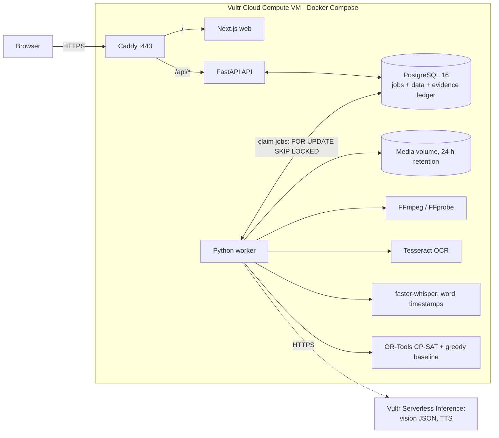

# SeeHere Architecture

Status: **Task 01 foundation.** Only the health path is implemented. Everything below the "Planned" line is design, implemented task by task (see `PROJECT_ROADMAP.md`).

## System overview



## Repository layout
```
seehere/
  backend/              Python 3.12 package `seehere` (uv)
    src/seehere/api/    FastAPI app (main.py, health.py)
    src/seehere/core/   settings (env-driven)
    src/seehere/providers/  provider protocols (STT, vision, text, TTS)
    tests/
  web/                  Next.js 16 (App Router, TypeScript, Tailwind 4)
  docs/                 architecture, ADRs, roadmap, task log, research
  docker-compose.dev.yml  local Postgres
  Makefile              dev commands
```

## Implemented in Task 01
| Endpoint | Purpose | Behaviour |
|---|---|---|
| `GET /api/health/live` | Liveness | `{"status":"ok"}` |
| `GET /api/health` | Readiness | Checks Postgres (real query), ffmpeg, ffprobe, tesseract (real binaries), AI-provider key presence (not capability). Returns 503 if DB/ffmpeg/ffprobe is down. Never leaks the DB URL |
| `GET /healthz` (web) | Web liveness | Per-request JSON |
| `GET /` (web) | Foundation page | Replaced in Task 03: the API status moved to `/status` |

## Web routes (Task 03)
All pages share one layout: skip link → sticky header (logo, Projects, Methodology, Upload lecture; a disclosure menu below 640px) → `<main id="main">` → footer (System status, Design system).

| Route | Rendering | Content |
|---|---|---|
| `/` | static | Landing: what SeeHere is designed to do, and how many pipeline stages are built |
| `/upload` | static shell, client form | Upload form: file, title, rights confirmation; limits and retention read from the API; XHR progress, cancel, server refusal reasons (Task 05) |
| `/projects` | static shell, client fetch | Live project list with loading, error/retry and empty states (Task 05) |
| `/projects/[projectId]/processing` | partial prerender | Breadcrumb with the project title; "Upload checked" facts measured by the server; live Analysis panel (job progress, cancel/retry, prepared audio and frame preview); stage list |
| `/projects/[projectId]/results` | partial prerender | Breadcrumb and section links; empty results |
| `/methodology` | static | Problem, pipeline with per-stage build status, verification states, modes, limits |
| `/status` | static shell, client fetch | Live `GET /api/health` in an `aria-live` region |
| `/design` | static | Design system reference |
| not found | static | `app/not-found.tsx`. `src/proxy.ts` returns a real 404 for malformed IDs and for projects the API reports missing; if the API cannot answer, the request continues to the error boundary |

Pipeline build status shown in the UI comes from one file, `web/src/lib/pipeline.ts`. A stage is flipped to `built` only in the commit that implements and tests it.

## Data model (Task 04)
18 tables in Postgres, created by one Alembic migration (`backend/migrations`), models in `backend/src/seehere/db/models/`:

- **Core:** `project` → `media_asset` (source video and derived files, with ffprobe output), `job` (queue rows for Task 06).
- **Analysis:** `transcript_segment` / `transcript_word`, `frame`, `slide`, `ocr_region`, `visual_unit`, `reference_link`.
- **Descriptions:** `description_cue`, `evidence`, `verification_event`, `schedule_run` / `schedule_placement`, `audio_clip`, `review_decision`, `export_artifact`.

Enums are text columns with CHECK constraints. Integrity rules (box ranges, time ordering, evidence sources, review edits, pause reasons) are enforced by Postgres. Every foreign key is indexed; deleting a project cascades.

## Upload API (Task 05)
| Endpoint | Behaviour |
|---|---|
| `GET /api/config/upload` | Size limit (bytes), duration limit (s), accept list, format names, retention hours |
| `POST /api/projects` | Body = raw file. Headers: `X-SeeHere-Title`, `X-SeeHere-Filename` (URL-encoded), `X-SeeHere-Rights-Confirmed: true`. Streams to a 0600 temp file under the size cap, identifies the content with ffprobe (`file:` protocol, `mov,matroska` demuxers only), requires video + audio streams and a duration within the limit, then atomically stores `{project_id}/source.{ext}` and creates the project and media rows. 201 → project |
| `GET /api/projects` | Newest first, up to 100 |
| `GET /api/projects/{id}` | Project with its source facts; 404 `not_found` |

Errors: `{"error": {"code", "message"}}` with 400 (rights/title/empty), 413 (too large), 415 (not a supported video), 422 (no video track, no audio, too long, invalid request). Storage paths and file hashes are never returned.

## Background jobs (Task 06)
One or more worker processes (`make worker`) share the Postgres `job` table (ADR-005):

```
upload ──(same transaction)──▶ job: queued ──claim (FOR UPDATE SKIP LOCKED)──▶ running
running ──handler ok──▶ succeeded
running ──unexpected error, attempts left──▶ queued (run_after = now + 10 s · 2^(n-1), max 300 s)
running ──PermanentJobError / out of attempts──▶ failed ──retry──▶ queued
queued ──cancel──▶ cancelled        running ──cancel──▶ cancel_requested ──▶ cancelled
running ──no heartbeat for 60 s (worker died)──▶ queued (or failed / cancelled)
```

Leases: every update after a claim requires `locked_by = <worker>`; a heartbeat thread refreshes it every 5 s. Delivery is at-least-once, so handlers replace their outputs. Users see only safe error messages; tracebacks stay in the worker log. Every 60 s each worker also recovers stale jobs and runs the retention sweep (expired projects: media directory and rows deleted; stale temp files removed).

| Endpoint | Behaviour |
|---|---|
| `GET /api/projects/{id}/jobs` | Jobs with status, stage, progress, attempts, safe error; plus the server clock |
| `POST /api/jobs/{id}/cancel` | Requires `X-SeeHere-Request: 1`. Queued → cancelled; running → stop requested. 409 if finished |
| `POST /api/jobs/{id}/retry` | Requires `X-SeeHere-Request: 1`. Failed/cancelled → queued as a fresh run. 409 otherwise |

## Media preparation (Task 07)
Job kind `media.prepare` (`seehere/media/normalize.py`): re-inspect the source → 16 kHz mono PCM WAV (`projects/{id}/audio_16k.wav`, verified) → frames at `frame_sample_fps` (default 1/s, max 1280 px wide; `projects/{id}/frames/{n}.jpg`, frame n = picture on screen at n/fps) → replace previous outputs in one transaction. ffmpeg runs argv-only with `-protocol_whitelist file`, the `mov,matroska` demuxers, a `file:` prefix, a timeout, and is killed on cancel.

| Endpoint | Behaviour |
|---|---|
| `GET /api/projects/{id}/media?preview=12` | Audio facts (rate, channels, duration, size); frame count, rate and range; up to 48 evenly spaced preview frames |
| `GET /api/frames/{id}/image` | The JPEG (resolved inside the media root only), `nosniff`, private cache |

## Speech-to-text (Task 08)
- Job `speech.transcribe` runs after `media.prepare` (queued in the same commit as the audio). One row per project; new audio re-queues it.
- Provider: local faster-whisper (`small.en`, int8, CPU) with word timestamps, the only TESTED STT (ADR-006). Vultr Whisper is an optional, untested text-only adapter.
- Output: `transcript_segment` and `transcript_word` (seconds of the source, ordered, inside the audio), linked to the normalized audio asset, so they are deleted when it is replaced. Served by `GET /api/projects/{id}/transcript`.

## Scene and slide changes (Task 09)
- Job `scenes.detect` after `media.prepare`. Thumbnails of the sampled frames are compared with the last keyframe; a keyframe is taken once the picture has changed and settled. Revisited slides reuse their earlier `scene_index` (dedupe).
- Output on `frame`: `is_keyframe`, `scene_index`, `phash` (dHash). Served in `GET /api/projects/{id}/media` as `scenes`.

## On-screen text (Task 10)
- Job `ocr.extract` after `scenes.detect`, on keyframes only. Tesseract TSV is grouped into lines → `ocr_region` (text as read, confidence 0–1, box as fractions of the frame). Served by `GET /api/projects/{id}/ocr`.
- `seehere.text.numbers` normalizes numbers from OCR and speech for later comparison; stored evidence is never rewritten.
- Job order per project: `media.prepare` → (`speech.transcribe`, `scenes.detect` → `ocr.extract` → `visual.analyze`) → `coverage.score` (queued by both branches).

## Slide decks (Task 11)
- `POST/GET /api/projects/{id}/deck`. Job `deck.ingest` reads pages (pypdf, or in-memory PPTX with zip-bomb, path and XML guards) into `slide` rows, aligned to keyframes by text similarity with OCR. OCR re-queues it.


## Visual units and seen versus said (Tasks 12-13)
- `visual.analyze`: per keyframe, OCR text blocks (default) or schema-validated Vultr vision units (`VISION_PROVIDER=vultr`, DOCUMENTED, off by default). One `visual_unit` per unit per appearance of the scene.
- `coverage.score`: compares each unit's words and numbers with transcript words in [start − 5 s, end + 5 s]; stores `coverage_score`, `priority`, said/unsaid. Served ranked by `GET /api/projects/{id}/visuals`.

## Planned pipeline (design)
1. **Ingest:** validate with ffprobe (never trust extensions), normalize, extract 16 kHz mono WAV.
2. **STT:** faster-whisper words with start/end/confidence, then sentences.
3. **Speech windows:** gaps ≥ threshold between words, padded, become safe placement windows.
4. **Scenes/slides:** sampled frames, scene-change detection and perceptual-hash dedupe give keyframes.
5. **OCR:** Tesseract TSV gives text, boxes and confidence per keyframe.
6. **Slides (optional upload):** PDF (pypdf) / PPTX (in-memory zip with guards, defusedxml) text, aligned to keyframes.
7. **Vision:** a Vultr VLM with a JSON schema returns visual units (kind, label, values, region). The response is schema-validated before storage.
8. **Seen vs said:** each unit's coverage against nearby transcript (normalized tokens + numbers).
9. **Deixis:** "this / here / the blue line" phrases are linked to a region via colour/label match, OCR boxes, pointer/highlight cues and temporal continuity. Each link gets a confidence; below the threshold it becomes NEEDS REVIEW.
10. **Evidence ledger:** rows linking description → unit → frame/region → OCR/slide → transcript span → verification events → scheduled cue.
11. **Generation:** S/M/L variants from the unit's fields only.
12. **Verification:** VERIFIED TEXT MATCH / CORROBORATED / UNCERTAIN / NEEDS HUMAN REVIEW per claim.
13. **Scheduling:** greedy baseline and CP-SAT. Standard mode allows no overlap. Extended mode allows budgeted pauses with a stated reason.
14. **TTS:** the measured duration is checked against its window. Re-solve on mismatch; reject if still invalid.
15. **Outputs:** WebVTT descriptions, cue audio, standard and extended MP4, accessible transcript, verification report, evidence manifest, zip.

The full data model arrives in Task 04, the queue in Task 06, and deployment in Task 34.
