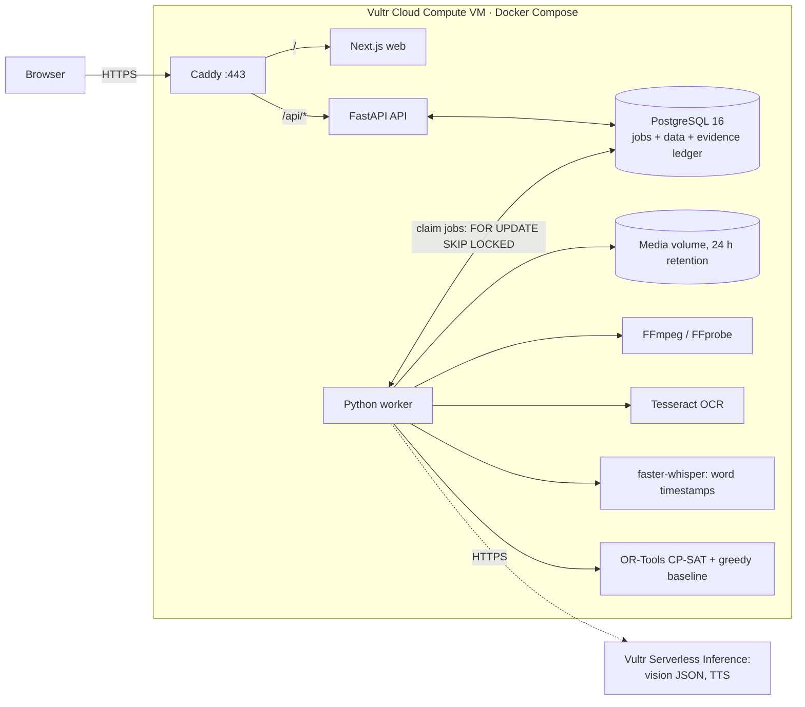

# SeeHere Architecture

Status: **Task 01 foundation.** Only the health path is implemented. Everything below the "Planned" line is design, implemented task by task (see `PROJECT_ROADMAP.md`).

## System overview



## Repository layout
```
seehere/
  backend/              Python 3.12 package `seehere` (uv)
    src/seehere/api/    FastAPI app (main.py, health.py)
    src/seehere/core/   settings (env-driven)
    src/seehere/providers/  provider protocols (STT, vision, text, TTS)
    tests/
  web/                  Next.js 16 (App Router, TypeScript, Tailwind 4)
  docs/                 architecture, ADRs, roadmap, task log, research
  docker-compose.dev.yml  local Postgres
  Makefile              dev commands
```

## Implemented in Task 01
| Endpoint | Purpose | Behaviour |
|---|---|---|
| `GET /api/health/live` | Liveness | `{"status":"ok"}` |
| `GET /api/health` | Readiness | Checks Postgres (real query), ffmpeg, ffprobe, tesseract (real binaries), AI-provider key presence (not capability). Returns 503 if DB/ffmpeg/ffprobe is down. Never leaks the DB URL |
| `GET /healthz` (web) | Web liveness | Per-request JSON |
| `GET /` (web) | Foundation page | Fetches `/api/health` and shows component status in an `aria-live` region |

## Planned pipeline (design)
1. **Ingest:** validate with ffprobe (never trust extensions), normalize, extract 16 kHz mono WAV.
2. **STT:** faster-whisper words with start/end/confidence, then sentences.
3. **Speech windows:** gaps ≥ threshold between words, padded, become safe placement windows.
4. **Scenes/slides:** sampled frames, scene-change detection and perceptual-hash dedupe give keyframes.
5. **OCR:** Tesseract TSV gives text, boxes and confidence per keyframe.
6. **Slides (optional upload):** PDF (PyMuPDF) / PPTX (python-pptx, safe unzip) text, aligned to keyframes.
7. **Vision:** a Vultr VLM with a JSON schema returns visual units (kind, label, values, region). The response is schema-validated before storage.
8. **Seen vs said:** each unit's coverage against nearby transcript (normalized tokens + numbers).
9. **Deixis:** "this / here / the blue line" phrases are linked to a region via colour/label match, OCR boxes, pointer/highlight cues and temporal continuity. Each link gets a confidence; below the threshold it becomes NEEDS REVIEW.
10. **Evidence ledger:** rows linking description → unit → frame/region → OCR/slide → transcript span → verification events → scheduled cue.
11. **Generation:** S/M/L variants from the unit's fields only.
12. **Verification:** VERIFIED TEXT MATCH / CORROBORATED / UNCERTAIN / NEEDS HUMAN REVIEW per claim.
13. **Scheduling:** greedy baseline and CP-SAT. Standard mode allows no overlap. Extended mode allows budgeted pauses with a stated reason.
14. **TTS:** the measured duration is checked against its window. Re-solve on mismatch; reject if still invalid.
15. **Outputs:** WebVTT descriptions, cue audio, standard and extended MP4, accessible transcript, verification report, evidence manifest, zip.

The full data model arrives in Task 04, the queue in Task 06, and deployment in Task 34.
