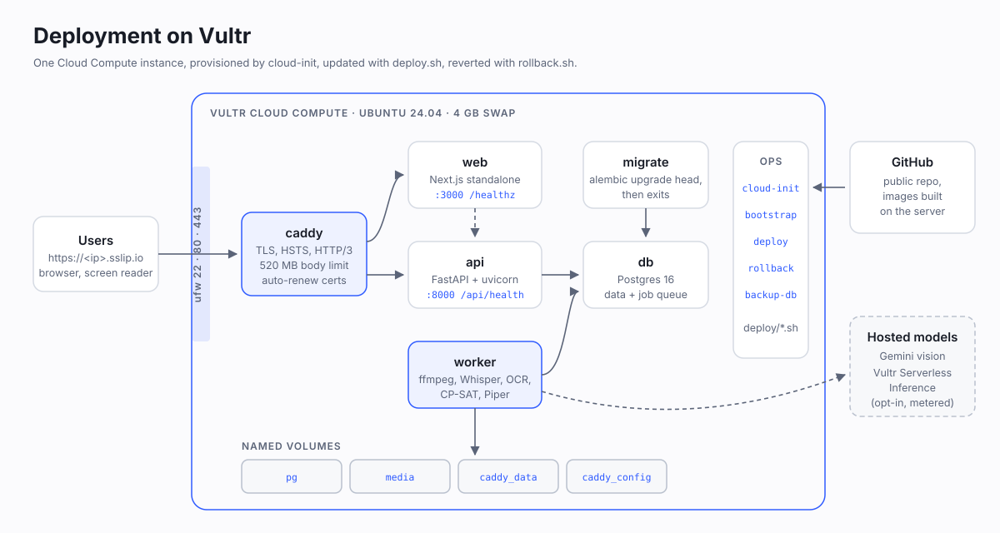

# Deploying SeeHere on Vultr

SeeHere runs on a single Vultr Cloud Compute instance with Docker Compose. Caddy serves it over HTTPS. There is no Kubernetes, no managed database, and no object storage: Postgres and the media files live on Docker volumes on the instance.



## What runs

| Service | Image | Role |
|---|---|---|
| `caddy` | `caddy:2.10-alpine` | HTTPS with automatic Let's Encrypt certificates, HSTS and HTTP/3. Sends `/api/*` to `api` and everything else to `web`. 520 MB request limit. |
| `web` | `seehere-web` (built from `web/Dockerfile`) | Next.js standalone server on :3000, running as `node`. Fetches data server-side from `http://api:8000`. |
| `api` | `seehere-backend` (built from `backend/Dockerfile`) | FastAPI on :8000, with `--proxy-headers` and `TRUST_PROXY_HEADERS=true`. |
| `worker` | `seehere-backend` | The 14-stage pipeline. On stop it finishes the current job first (up to 90 s). |
| `migrate` | `seehere-backend` | Runs `alembic upgrade head` once, before `api` and `worker` start. |
| `db` | `postgres:16-alpine` | Data and the job queue. Not exposed outside the Docker network. |

Only Caddy publishes ports (80, 443, 443/udp). The `ufw` firewall allows 22, 80 and 443.

Named volumes:
- `pg`: the database.
- `media`: uploads, audio, frames, voice clips and exports. Deleted after `MEDIA_RETENTION_HOURS`.
- `caddy_data` and `caddy_config`: certificates.

The backend image ships ffmpeg, Tesseract, the faster-whisper `small.en` model and the Piper `en_US-ljspeech-medium` voice. The worker runs offline (`HF_HUB_OFFLINE=1`) unless a hosted vision model or TTS is turned on.

## Size of the instance

These are measured locally (`bench/results/perf-*.md`):
- The worker's peak memory was about 1.7 GB, during speech-to-text on a 30-minute lecture.
- A 10-minute lecture took 59 s from upload to ready.
- A 30-minute lecture took 157 s.

| Plan | Use |
|---|---|
| 2 vCPU / 4 GB | Minimum. Works with the 4 GB swap that bootstrap adds; longer lectures are slower. |
| **4 vCPU / 8 GB** | Recommended for a public demo. |

Check the current monthly price for your region in the Vultr console before you deploy. Cloud Compute is billed hourly up to the monthly cap. Destroying the instance stops billing; stopping it does not.

## First deployment

Before you start:
- The repository must be public on GitHub. The instance clones it.
- You need a Vultr account with credit.

1. Go to Vultr console → **Deploy** → **Cloud Compute**. Choose a region near your users, **Ubuntu 24.04 LTS x64**, and the plan from the table above.
2. Under **Server Settings**, add your SSH key.
3. Under **Additional Features** → **Cloud-Init User-Data**, paste [`deploy/cloud-init.yaml`](../deploy/cloud-init.yaml).
4. Deploy. On first boot, `deploy/bootstrap.sh` does the following:
   - installs Docker from Docker's apt repository;
   - sets up the firewall;
   - adds 4 GB of swap;
   - writes `deploy/.env`, using `<ip-with-dashes>.sslip.io` as the domain and a random database password;
   - builds the images and starts the stack.

   The first build takes about 10–15 minutes. To follow it:

   ```bash
   ssh root@<ip> 'tail -f /var/log/seehere-bootstrap.log'
   ```

5. When the log prints `SeeHere is live at https://<ip>.sslip.io`, open that URL.

**Without cloud-init:** SSH in and run the bootstrap script directly. It is safe to re-run, and it keeps an existing `.env`.

```bash
ssh root@<ip> 'curl -fsSL https://raw.githubusercontent.com/priyansh-narang2308/seehere/main/deploy/bootstrap.sh | bash'
```

**Your own domain:** point an A record at the instance. Then set `SEEHERE_DOMAIN` in `/opt/seehere/deploy/.env` and run `deploy/deploy.sh`.

## Settings

`/opt/seehere/deploy/.env` is created from [`deploy/.env.prod.example`](../deploy/.env.prod.example). It has mode 600 and is never committed.

| Setting | Default | Notes |
|---|---|---|
| `SEEHERE_DOMAIN` | `<ip>.sslip.io` | Caddy requests the certificate for this name. |
| `POSTGRES_PASSWORD` | random | Generated by bootstrap. |
| `VISION_PROVIDER` | `none` | `gemini` or `vultr` sends each keyframe to a vision model. If the model fails, it falls back to OCR. |
| `GEMINI_API_KEY` | empty | Needed when `VISION_PROVIDER=gemini`. |
| `VULTR_INFERENCE_API_KEY` | empty | A **Serverless Inference** key (Vultr console → Serverless Inference). This is not the account API key. |
| `TTS_PROVIDER` | `piper` | Local voice, no per-request cost. |
| `MEDIA_RETENTION_HOURS` | 24 | Expired projects are deleted with all their files. |
| `MAX_UPLOAD_MB` / `MAX_VIDEO_DURATION_S` | 500 / 1800 | Caddy's body limit is 520 MB. |

After changing settings, apply them:

```bash
cd /opt/seehere/deploy && docker compose -f docker-compose.prod.yml up -d
```

## Updating and rolling back

```bash
bash /opt/seehere/deploy/deploy.sh     # pull, tag current images :previous, rebuild, migrate, restart, health check
bash /opt/seehere/deploy/rollback.sh   # start the :previous images again
bash /opt/seehere/deploy/backup-db.sh  # gzip pg_dump into deploy/backups/, keeps 7
```

Migrations in this project only add columns and tables, so the previous images run on the newer schema. If a future release removes or renames columns, restore the backup taken before that release as well.

## Checks

```bash
curl -fsS https://<domain>/api/health        # database and migration state
curl -fsS https://<domain>/api/health/live   # process is up
curl -fsSI https://<domain>/ | grep -i strict-transport
docker compose -f docker-compose.prod.yml ps   # every service healthy, migrate exited 0
```

The Status page (`/status`) shows the health of the API, database and media tools, measured stage timings and hosted-model calls.

## Security notes

- HTTPS only; Caddy sends HSTS and removes the `Server` header. The API adds its own security headers and rate limits.
- Every write needs the `X-SeeHere-Request: 1` header.
- Postgres, the API and the web server are reachable only inside the Docker network.
- Containers run as non-root users: `seehere` (uid 10001) and `node`.
- Logs are rotated (10 MB × 5 per container). They hold IDs and HTTP codes, never transcript or description text.
- Secrets live only in `deploy/.env` on the server.

## Cost control

The local tools have no per-request cost: Whisper, Tesseract, OR-Tools and Piper.
- **Instance:** the only fixed cost is the instance itself.
- **Hosted models:** a hosted vision model adds one request per keyframe. The Status page and `GET /api/metrics` count every call, its tokens and its latency.
- **Dollar figures:** these appear only when you set the unit price (`VULTR_PRICE_PER_*`).
- **When you are done:** destroy the instance in the Vultr console to stop billing.
